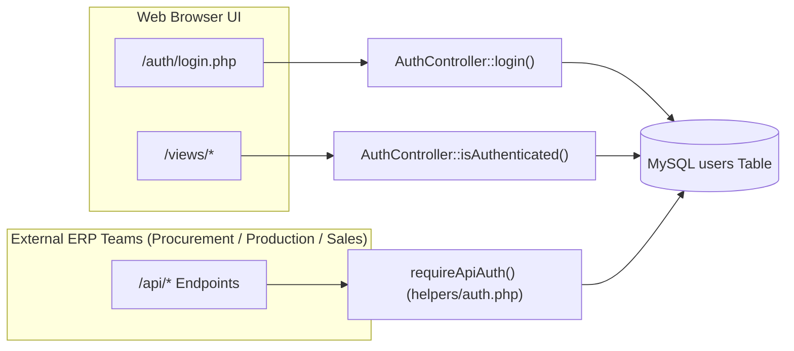

# Authentication & Authorization Guide (`AUTH.md`)

**System:** InventoryTeam — Liquor Business Inventory Management System  
**Core Files:** [`controllers/AuthController.php`](controllers/AuthController.php), [`helpers/auth.php`](helpers/auth.php), [`config/bootstrap.php`](config/bootstrap.php)

---

## 1. Overview

InventoryTeam uses a **dual authentication architecture** designed for both human warehouse operators (via Web UI sessions) and cross-team ERP microservices (via stateless API Bearer tokens):



---

## 2. Web Session Authentication (`AuthController`)

### 2.1 Sign-In & Credential Verification
- **Dual Identifier Support:** Users can sign in using either their `email` or `username` ([`controllers/AuthController.php`](controllers/AuthController.php)).
- **Password Verification:** Passwords are verified against `PASSWORD_BCRYPT` hashes using PHP's timing-attack-safe `password_verify()`.
- **Account Status Check:** Only accounts with `status = 'Active'` are permitted to log in.
- **Session Fixation Protection:** Upon successful login, `session_regenerate_id(true)` and `regenerateCsrfToken()` are executed immediately.

### 2.2 Brute-Force Rate Limiting
- **Max Attempts:** `5` failed login attempts (`AuthController::LOGIN_MAX_ATTEMPTS`).
- **Lockout Window:** `300 seconds` (5 minutes, `AuthController::LOGIN_LOCKOUT_SECONDS`).
- **Tracking:** Failed attempts are tracked per email and client IP address to block credential-stuffing attacks.

### 2.3 Session Lifecycle & Live Revalidation
- **Hardened Session Cookies:** Configured centrally in [`config/bootstrap.php`](config/bootstrap.php) via `startSecureSession()`:
  - `session.cookie_httponly = 1` (prevents JavaScript `document.cookie` theft)
  - `session.cookie_samesite = Lax` (mitigates cross-site request forgery)
  - `session.use_strict_mode = 1` (rejects uninitialized session IDs)
- **Idle Timeout:** `1800 seconds` (30 minutes of inactivity) automatically invalidates the session.
- **Zero-Delay Account Revalidation (`F-23`):** On every authenticated request (`ACCOUNT_REVALIDATE_SECONDS = 0`), `AuthController::isAuthenticated()` queries the `users` table to verify the user's `status`, `role`, `team`, and `warehouse_id`. If a Super Admin deactivates a user or changes their warehouse, the change takes effect on the user's very next click.

### 2.4 Self-Service OTP Password Reset
1. **Step 1 (`requestPasswordReset`):** Generates a 6-digit cryptographic OTP (`random_int(100000, 999999)`) valid for 15 minutes (`900s`). Returns a uniform response to prevent email enumeration (`F-27`).
2. **Step 2 (`verifyPasswordResetCode`):** Validates the 6-digit OTP using constant-time `hash_equals()` and caps verification attempts at `5`.
3. **Step 3 (`completePasswordReset`):** Consumes the one-time reset token and updates the user's `PASSWORD_BCRYPT` hash.

---

## 3. REST API Bearer Token Authentication (`helpers/auth.php`)

External ERP subsystems (**Procurement**, **Production**, **Sales**) and authorized scripts authenticate to `/api/*` endpoints using Bearer tokens.

### 3.1 Token Transmission
Clients pass their raw 64-character token in the HTTP header:
```http
Authorization: Bearer <64-char-hex-token>
```
*(Fallback header `X-Api-Key: <64-char-hex-token>` is also supported).*

### 3.2 SHA-256 Token Hashing at Rest (`SEC-04`)
- Raw API tokens are **never** stored in plain text in the database.
- When a user account is created or its token is regenerated in [`views/users/index.php`](views/users/index.php), a 32-byte random token (`bin2hex(random_bytes(32))`) is shown **once** to the Super Admin, while only its ` hash('sha256', $rawToken) ` digest is stored in `users.api_token`.
- On every API request, `requireApiAuth()` hashes the incoming Bearer token with SHA-256 and queries:
  ```sql
  SELECT user_id, name, email, role, team, warehouse_id, api_token, status
  FROM users
  WHERE api_token = ? AND status = 'active'
  LIMIT 1
  ```

---

## 4. Role-Based Access Control (RBAC) & Team Separation

InventoryTeam enforces strict separation between **System Roles** and **Functional Teams** (`checkApiAuthorization()` in [`helpers/auth.php`](helpers/auth.php)):

| Role | Functional Team | Warehouse Scope | Permitted Operations |
| :--- | :--- | :--- | :--- |
| `super_admin` | `Administration` / `Inventory` | **Global** (All Warehouses) | Full access to all views, User Directory, Item Approval, Adjustments Approval, and all APIs. |
| `admin` | `Inventory` / `Administration` | **Assigned Warehouse Only** | Manage warehouse stock, receive/dispatch orders, create transfers/adjustments, manage catalog items. Cannot access User Directory (`403`). |
| `admin` / `user` | `Procurement` | **Assigned Warehouse Only** | Create & cancel Inbound Orders (`/api/inbound_order/*`), query raw material stock. |
| `admin` / `user` | `Production` | **Assigned Warehouse Only** | Create Inbound FG Receipts & Outbound RM Requests, query stock balances. |
| `admin` / `user` | `Sales` | **Assigned Warehouse Only** | Create & cancel Outbound Sales Orders (`/api/outbound_order/*`), query finished goods stock. |

### Key Authorization Guards
- **`isWarehouseAdmin(array $user)`:** Returns `true` strictly for `super_admin` or internal `Inventory`/`Administration` admins. External ERP service accounts (`Procurement`, `Production`, `Sales`) always return `false`.
- **`checkApiAuthorization(array $user, array $allowed)`:** Ensures external team tokens only match endpoints that explicitly list their team (e.g., `requireApiAuth(['procurement', 'inventory'])`).

---

## 5. Multi-Warehouse Facility Isolation

Every non-Super Admin operator is bound to a single physical facility (`users.warehouse_id`, e.g., `WH-MAIN`, `WH-BOND`, `WH-BOTT`):
- **Web UI Isolation:** [`views/layouts/header.php`](views/layouts/header.php) pins non-Super Admins to their assigned `warehouse_id`. Only `super_admin` can switch active facilities using the top navbar selector.
- **API Isolation:** `resolveWarehouseScope($authUser, $requestedWarehouseId)` in [`helpers/auth.php`](helpers/auth.php) automatically rejects cross-warehouse API requests from non-Super Admins with `403 Forbidden`.
