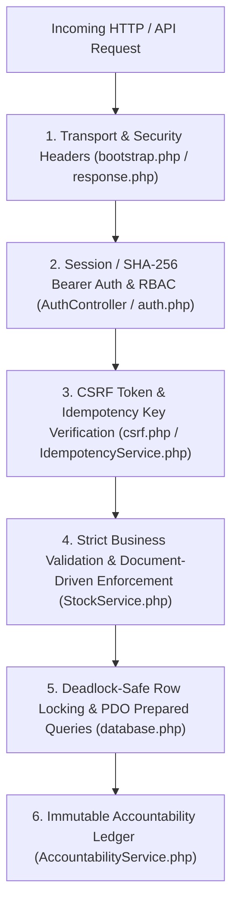

# Security Architecture & Policy (`SECURITY.md`)

**System:** InventoryTeam — Liquor Business Inventory Management System  
**Core Files:** [`config/bootstrap.php`](config/bootstrap.php), [`config/database.php`](config/database.php), [`helpers/csrf.php`](helpers/csrf.php), [`helpers/auth.php`](helpers/auth.php), [`helpers/StockService.php`](helpers/StockService.php), [`helpers/AccountabilityService.php`](helpers/AccountabilityService.php)

---

## 1. Defense-in-Depth Overview

InventoryTeam implements multiple overlapping security layers across the HTTP transport layer, session management, form/API validation, database transactions, and audit logging.

---

## 2. Application & Database Security Controls

### 2.1 SQL Injection Prevention & Strict SQL Mode
- **Real Prepared Statements:** [`config/database.php`](config/database.php) configures PDO with `PDO::ATTR_EMULATE_PREPARES => false` and `PDO::ATTR_ERRMODE => PDO::ERRMODE_EXCEPTION`. SQL structure and user parameters are sent separately to MariaDB/MySQL.
- **Strict Transactional Mode (`F-30`):** Every database connection enforces `STRICT_TRANS_TABLES` so numeric overflows, missing required fields, or invalid `ENUM` values fail immediately inside transactions rather than silently truncating data.
- **Timezone Alignment (`F-25`):** PHP and MariaDB session clocks are synchronized to the configured business timezone (`Asia/Manila` / `+08:00`) on every connection.

### 2.2 Cross-Site Request Forgery (CSRF) Protection
- **Per-Session 256-Bit Token:** [`helpers/csrf.php`](helpers/csrf.php) generates a 32-byte cryptographic token (`bin2hex(random_bytes(32))`) stored in `$_SESSION['csrf_token']`.
- **Constant-Time Verification:** Every state-changing `POST` form across all views (`items`, `users`, `inbound_outbound`, `stock_operations`, `settings`) validates the token using `hash_equals()` via `validateCsrfToken()`.
- **Token Rotation:** CSRF tokens are automatically rotated upon user login (`regenerateCsrfToken()`).

### 2.3 Cross-Site Scripting (XSS) & Content Sniffing Protection
- **Output Escaping:** All dynamic values rendered in HTML views are escaped with `htmlspecialchars(..., ENT_QUOTES, 'UTF-8')`.
- **HTTP Security Headers (`SEC-05`):** Emitted centrally by `emitSecurityHeaders()` in [`config/bootstrap.php`](config/bootstrap.php):
  - `X-Content-Type-Options: nosniff`
  - `X-Frame-Options: DENY` (prevents clickjacking)
  - `Referrer-Policy: strict-origin-when-cross-origin`
  - `Cache-Control: no-store, no-cache, must-revalidate, max-age=0` on all authenticated pages to prevent browser back-button cache snooping.

### 2.4 Transport Security, CORS & Trusted Proxies
- **HTTPS Enforcement (`SEC-06`):** When `APP_ENV=production` or `ENFORCE_HTTPS=true`, `enforceHttpsSecurity()` in [`helpers/auth.php`](helpers/auth.php) blocks plain-HTTP API requests with `403HTTPS Required` to protect Bearer credentials in transit.
- **Trusted Proxy Verification (`F-09`):** Forwarded headers (`X-Forwarded-Proto`, `X-Forwarded-For`) are only trusted when `REMOTE_ADDR` matches the explicit `TRUSTED_PROXIES` allowlist in `.env`.
- **Directory Protection:** Sensitive backend directories (`config/.htaccess`, `database/`, etc.) deny direct web access.

---

## 3. Inventory Ledger Integrity & Concurrency Controls

### 3.1 Concurrency & Deadlock Prevention
- **Pessimistic Row-Level Locking (`FOR UPDATE`):** All stock mutations (`StockService`, `OrderService`) lock affected `stock`, `inbound_orders`, and `outbound_orders` rows inside atomic database transactions (`beginTransaction()` -> `commit()` / `rollBack()`).
- **Deterministic Lock Ordering:** Whenever a batch request contains multiple items, item IDs are **sorted in ascending order (`ksort` / `usort`)** before acquiring `SELECT ... FOR UPDATE` locks. This guarantees that two concurrent requests locking the same items never deadlock each other.
- **Reserved Stock Protection (`F-14`):** Outbound dispatches, transfers, and damaged stock write-offs verify available unreserved balance (`qty_on_hand - qty_reserved`) while holding the row lock, preventing negative stock.

### 3.2 API Idempotency Protection
- Mutating API endpoints support the `Idempotency-Key` header via [`helpers/IdempotencyService.php`](helpers/IdempotencyService.php) and the `api_idempotency_keys` table, preventing duplicate stock movements when network retries occur.

### 3.3 Strict Document-Driven Mode
- Manual, unreferenced stock additions and deductions are disabled on `/api/stock_in/create.php` and `/api/stock_out/create.php`. Every inbound receipt and outbound dispatch must be tied to an authorized Purchase/Inbound Order or Sales/Production Outbound Order.

---

## 4. Immutable Audit & Accountability Trail

Every sensitive administrative and inventory action—including user creation/updates, API token regeneration, catalog item creation/approval, inbound receipts, outbound dispatches, inter-warehouse transfers, stock adjustments, and damaged stock write-offs—is recorded via [`helpers/AccountabilityService.php`](helpers/AccountabilityService.php) into the `accountability_logs` table with:
- Operator `user_id` & functional `team`
- Channel (`UI` or `API`)
- Facility `warehouse_id` & `item_id`
- Document `reference_number` & detailed audit notes
- Timestamp & client metadata

---

## 5. Reporting a Vulnerability

If you discover a security issue in InventoryTeam:
1. **Do not** open a public issue containing exploit details or live credentials.
2. Contact the Super Administrator or project lead directly with the affected endpoint/file path and reproduction steps.
3. Rotate any affected API Bearer tokens immediately via **Users & Account Management -> Regenerate API Bearer Token** ([`views/users/index.php`](views/users/index.php)).
