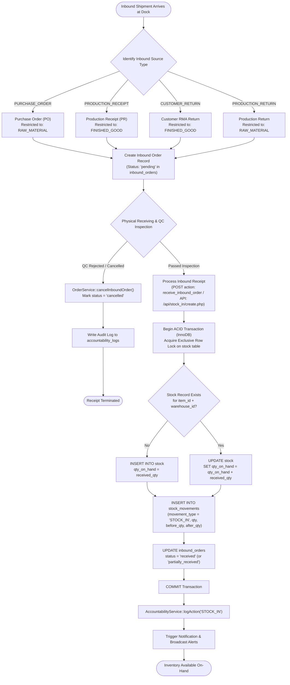

# System Flowcharts & Operational Architecture (`SYSTEM_FLOWCHARTS.md`)

**System:** InventoryTeam &mdash; Liquor Business Inventory Management System  
**Scope:** Internal Warehouse Management & External B2B Cross-Department ERP Ecosystem  
**Key Codebase Components:** [`helpers/StockService.php`](helpers/StockService.php), [`helpers/OrderService.php`](helpers/OrderService.php), [`helpers/AccountabilityService.php`](helpers/AccountabilityService.php), [`controllers/AuthController.php`](controllers/AuthController.php), [`views/inbound_outbound/`](views/inbound_outbound/), [`views/stock_operations/`](views/stock_operations/), [`api/`](api/)

---

## 1. High-Level ERP System Ecosystem & Cross-Department Handshake

```mermaid
flowchart TD
    classDef procurement fill:#e0f2fe,stroke:#0284c7,stroke-width:2px,color:#0369a1;
    classDef production fill:#fef3c7,stroke:#d97706,stroke-width:2px,color:#b45309;
    classDef sales fill:#fce7f3,stroke:#db2777,stroke-width:2px,color:#be185d;
    classDef warehouse fill:#dcfce7,stroke:#16a34a,stroke-width:2px,color:#15803d;
    classDef admin fill:#f3e8ff,stroke:#9333ea,stroke-width:2px,color:#7e22ce;

    subgraph Procurement_Team["Procurement Department"]
        PO["Purchase Order (PO)<br/>Raw Materials Only"]:::procurement
        RTV_REQ["Supplier Return Request (RTV)"]:::procurement
    end

    subgraph Production_Team["Production / Distillery"]
        MR["Material Request (MR)<br/>Ingredients & Packaging"]:::production
        PR["Production Receipt (PR)<br/>Bottled Finished Goods"]:::production
        PR_RET["Production Return<br/>Unused Materials"]:::production
    end

    subgraph Sales_Team["Sales & Distribution"]
        SO["Sales Delivery Order (SO)<br/>Finished Goods"]:::sales
        RMA["Customer Return (RMA)<br/>Finished Goods Defect"]:::sales
    end

    subgraph Inventory_Team["Warehouse Operations (InventoryTeam)"]
        InboundQueue["Inbound Order Queue<br/>(views/inbound_outbound)"]:::warehouse
        OutboundQueue["Outbound Order Queue<br/>(views/inbound_outbound)"]:::warehouse
        DockQC["Dock Receiving & QC Inspection"]:::warehouse
        DispatchStage["Picking, Staging & Dispatch"]:::warehouse
        WhOps["Internal Warehouse Operations<br/>(Transfers / Adjustments / Bad Products)"]:::warehouse
        StockLedger[("Central Stock & Movement Ledger<br/>(stock & stock_movements)")]:::warehouse
    end

    subgraph Admin_Team["Administration & Governance"]
        SuperAdmin["Super Admin<br/>Catalog Approval & Role Scoping"]:::admin
        AuditTrail[("Accountability Audit Trail<br/>(accountability_logs)")]:::admin
    end

    %% Inbound Connections
    PO -->|REST API / PO Doc| InboundQueue
    PR -->|REST API / Batch Manifest| InboundQueue
    RMA -->|RMA Request| InboundQueue
    PR_RET -->|Material Restock| InboundQueue

    InboundQueue --> DockQC
    DockQC -->|StockService::recordStockIn()| StockLedger

    %% Outbound Connections
    MR -->|REST API / Production Order| OutboundQueue
    SO -->|REST API / B2B Sale| OutboundQueue
    RTV_REQ -->|Supplier Claim| OutboundQueue

    OutboundQueue --> DispatchStage
    DispatchStage -->|StockService::recordStockOut()| StockLedger

    %% Internal Warehouse Actions
    StockLedger <-->|Transfers / Counts / Quarantine| WhOps

    %% Governance & Audit
    SuperAdmin -->|Approve New Items / Manage Users| StockLedger
    StockLedger -.->|Transaction Events| AuditTrail
    WhOps -.->|State Transitions| AuditTrail
    DockQC -.->|Inspection Logs| AuditTrail
    DispatchStage -.->|Dispatch Logs| AuditTrail
```

---

## 2. Inbound Order & Receiving Flowchart (Stock In)



---

## 3. Outbound Order, Reservation & Dispatch Flowchart (Stock Out)

```mermaid
flowchart TD
    StartOut(["Outbound Request Initiated"]) --> IdentifyDest{"Identify Outbound Source Type"}

    IdentifyDest -->|SALES_DELIVERY| SDType["Sales Delivery (SO)<br/>Finished Goods to Customers"]
    IdentifyDest -->|MATERIAL_REQUEST| MRType["Material Request (MR)<br/>Raw Materials to Distillery/Production"]
    IdentifyDest -->|SUPPLIER_RETURN| RTVType["Supplier Return (RTV)<br/>Defective Raw Materials to Vendor"]

    SDType --> CreateOutboundDoc["Create Outbound Order Record<br/>(Status: 'pending' in outbound_orders)"]
    MRType --> CreateOutboundDoc
    RTVType --> CreateOutboundDoc

    CreateOutboundDoc --> LiveStockCheck{"Stock Availability Check<br/>(qty_on_hand >= requested_qty)"}

    LiveStockCheck -->|Insufficient Stock| HoldQueue["Queue Blocked: Status 'pending'<br/>Low-Stock Notification Triggered"]
    HoldQueue --> CheckRestock{"Restock or Inbound Received?"}
    CheckRestock -->|Yes| LiveStockCheck
    CheckRestock -->|Cancelled by Department| CancelOutbound["OrderService::cancelOutboundOrder()<br/>Release Reservations & Mark 'cancelled'"]

    LiveStockCheck -->|Stock Sufficient| ReserveStock["Reserve Stock Allocation<br/>Status = 'reserved'"]

    ReserveStock --> DockPicking["Warehouse Dock: Picking, Packing & Verification"]
    DockPicking --> ConfirmDispatch{"Confirm Physical Dispatch"}

    ConfirmDispatch -->|Dispatch Rejected / Cancelled| CancelOutbound
    CancelOutbound --> LogCancelAudit["Write Audit Log to accountability_logs"] --> EndOutCancelled(["Outbound Order Cancelled"])

    ConfirmDispatch -->|Confirmed Dispatch| ExecDispatch["StockService::recordStockOut()<br/>(POST action: dispatch_outbound_order / API: /api/stock_out/create.php)"]

    ExecDispatch --> BeginOutTxn["Begin ACID Transaction<br/>Lock stock rows with canonical item_id order (F-31)"]
    BeginOutTxn --> DeductStock["UPDATE stock<br/>SET qty_on_hand = qty_on_hand - dispatched_qty"]
    DeductStock --> WriteMovement["INSERT INTO stock_movements<br/>(movement_type = 'STOCK_OUT', qty, before_qty, after_qty)"]
    WriteMovement --> UpdateOutStatus["UPDATE outbound_orders<br/>SET status = 'dispatched'"]
    UpdateOutStatus --> CommitOutTxn["COMMIT Transaction"]

    CommitOutTxn --> WriteAuditOut["AccountabilityService::logAction('STOCK_OUT')"]
    WriteAuditOut --> CheckReorder{"qty_on_hand <= reorder_level?"}
    CheckReorder -->|Yes| TriggerReorderAlert["Emit Reorder & Low-Stock Alert Notification"]
    CheckReorder -->|No| CompleteOut
    TriggerReorderAlert --> CompleteOut
    CompleteOut --> EndOutSuccess(["Goods Dispatched & Stock Decremented"])
```



---

## 4. Internal Warehouse Operations Flowchart (Transfers, Adjustments & Bad Products)

```mermaid
flowchart TD
    classDef transfer fill:#e0f2fe,stroke:#0284c7,stroke-width:1px;
    classDef adjustment fill:#fef3c7,stroke:#d97706,stroke-width:1px;
    classDef badproduct fill:#fee2e2,stroke:#dc2626,stroke-width:1px;

    subgraph Op1["Stock Transfers (Inter-Warehouse)"]
        T1["Initiate Transfer<br/>Source -> Destination Warehouse"]:::transfer --> T2{"Source Stock Sufficient?"}:::transfer
        T2 -->|No| TFail["Reject Transfer Creation"]:::transfer
        T2 -->|Yes| T3["Deduct Source Warehouse stock<br/>INSERT stock_transfers (status = 'in_transit')<br/>INSERT stock_movements ('TRANSFER_OUT')"]:::transfer
        T3 --> T4{"Destination Warehouse Action"}:::transfer
        T4 -->|Confirm Receipt| T5["Increment Destination Warehouse stock<br/>UPDATE stock_transfers (status = 'received')<br/>INSERT stock_movements ('TRANSFER_IN')"]:::transfer
        T4 -->|Cancel Transfer| T6["Refund stock back to Source Warehouse<br/>UPDATE stock_transfers (status = 'cancelled')<br/>INSERT stock_movements ('TRANSFER_CANCELLED')"]:::transfer
    end

    subgraph Op2["Stock Adjustments (Physical Audits & Cycle Counts)"]
        A1["Warehouse Operator Enters Physical Count Variance"]:::adjustment --> A2["INSERT stock_adjustments<br/>(status = 'pending', discrepancy_qty)"]:::adjustment
        A2 --> A3{"Managerial / Super Admin Review"}:::adjustment
        A3 -->|Reject / Cancel| A4["UPDATE status = 'rejected' / 'cancelled'<br/>No stock level modified"]:::adjustment
        A3 -->|Approve Adjustment| A5["Acquire Row Lock on stock table<br/>Apply Delta (+ / -) to qty_on_hand<br/>INSERT stock_movements ('ADJUSTMENT_ADD'/'ADJUSTMENT_SUB')<br/>UPDATE status = 'approved'"]:::adjustment
    end

    subgraph Op3["Bad Products (Damaged / Expired Goods Lifecycle)"]
        B1["Identify Broken/Defective Items (e.g. Broken Bottles)"]:::badproduct --> B2["Quarantine from Stock:<br/>Deduct qty_on_hand from available stock<br/>INSERT bad_products (status = 'quarantined')"]:::badproduct
        B2 --> B3{"QA Inspection / Assessment"}:::badproduct
        B3 -->|Cancel Quarantine / False Alarm| B4["Restore Stock to available qty_on_hand<br/>UPDATE bad_products (status = 'cancelled')"]:::badproduct
        B3 -->|Confirm Damage| B5["UPDATE bad_products (status = 'confirmed')"]:::badproduct
        B5 --> B6["Authorize Physical Disposal / Destruction"]:::badproduct
        B6 --> B7["INSERT stock_movements ('BAD_PRODUCT_DISPOSAL')<br/>UPDATE bad_products (status = 'disposed')<br/>Record Accountability Waste Audit"]:::badproduct
    end
```



---

## 5. Security & Dual Architecture Processing Flowchart

```mermaid
flowchart TD
    ClientReq["Incoming HTTP Request"] --> Entry{"Request Entry Point"}

    %% Web UI SSR Flow
    Entry -->|Web Browser /views/*| SSR["Server-Side Rendered (SSR) Web Portal"]
    SSR --> SessionCheck{"Valid PHP Session Cookie?<br/>(cookie_httponly, Lax)"}
    SessionCheck -->|No| RedirectLogin["Redirect to /auth/login.php"]
    SessionCheck -->|Yes| VerifyCSRF{"HTTP Method == 'POST'?"}
    VerifyCSRF -->|Yes| CSRFCheck{"hash_equals(_csrf_token, $_POST['csrf_token'])"}
    CSRFCheck -->|Invalid| Deny403["403 Forbidden: Invalid CSRF Token"]
    CSRFCheck -->|Valid| RotateCSRF["Rotate CSRF Token on sensitive actions"]
    VerifyCSRF -->|No (GET)| FacilityCheck
    RotateCSRF --> FacilityCheck{"Warehouse Facility Scoping (F-07)<br/>User Assigned to Warehouse or Super Admin?"}
    FacilityCheck -->|Mismatch| Scope403["403 Forbidden: Facility Mismatch"]
    FacilityCheck -->|Authorized| ExecuteController["Execute StockService / OrderService Action"]

    %% External REST API Flow
    Entry -->|REST API /api/*| API["External B2B RESTful Integration Suite"]
    API --> HTTPSCheck{"Production Mode & HTTPS Enforced?"}
    HTTPSCheck -->|Plain HTTP| DenyHTTPS["403 HTTPS Required"]
    HTTPSCheck -->|Valid Transport| RateLimitCheck{"Rate Limiter Check<br/>(Redis / APCu / DB token bucket)"}
    RateLimitCheck -->|Exceeded| Deny429["429 Too Many Requests"]
    RateLimitCheck -->|Allowed| TokenAuth{"Bearer Token Header Present?<br/>(hash_equals(SHA-256))"}
    TokenAuth -->|Invalid| Deny401["401 Unauthorized: Invalid Token"]
    TokenAuth -->|Valid| RBACDeptCheck{"Team Department Scoping (RBAC)<br/>Procurement / Production / Sales / Admin"}
    RBACDeptCheck -->|Unauthorized Dept| DenyRBAC["403 Forbidden: Scope Mismatch"]
    RBACDeptCheck -->|Authorized| IdempotencyCheck{"X-Idempotency-Key Header Provided?"}
    IdempotencyCheck -->|Cached Response Exists| ReturnCached["Return Cached HTTP 200 (No duplicate execution)"]
    IdempotencyCheck -->|New or None| ExecuteAPI["Execute REST Controller Action"]

    %% Execution & Commit
    ExecuteController --> DBTxn["ACID InnoDB Transaction<br/>(STRICT_TRANS_TABLES, Row Locks, Deadlock-Safe Sorting)"]
    ExecuteAPI --> DBTxn

    DBTxn --> WriteAuditTrail["AccountabilityService::logAction()<br/>(user_id, IP, user_agent, entity, details)"]
    WriteAuditTrail --> ReturnResponse["Return HTML View (SSR) / Standard JSON Response (API)"]
```
